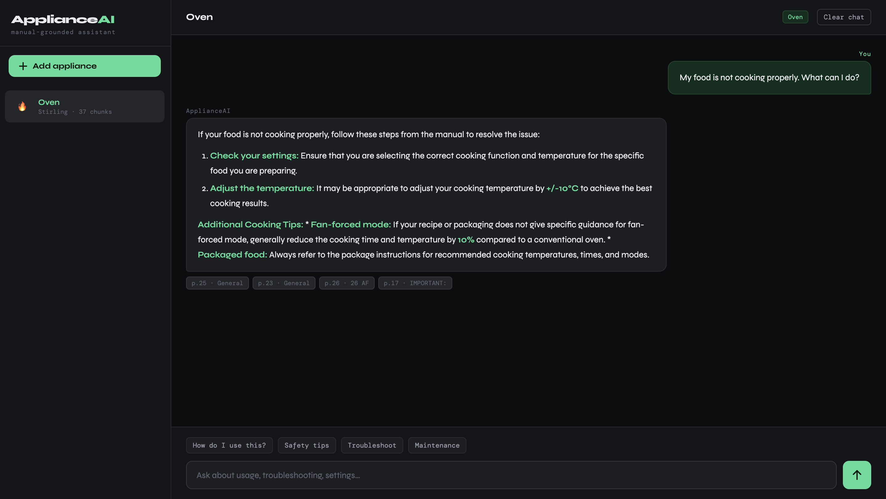

# AskAppliance

A domain-specific AI assistant that answers questions about home appliances by reasoning over their official PDF manuals.



Upload an appliance manual (PDF), then ask about usage, settings, troubleshooting, safety or maintenance. Every answer is grounded in the manual and shows the page and section it came from.

## Stack

| Layer | Tool |
|-------|------|
| LLM | Gemini (gemini-3.6-flash) |
| Embeddings | Gemini gemini-embedding-001 |
| PDF text | PyMuPDF (fitz) |
| PDF tables | pdfplumber |
| Vector search | FAISS (one index per appliance) |
| Backend | FastAPI + SQLAlchemy async |
| Database | SQLite (aiosqlite) |
| Frontend | Vanilla HTML/CSS/JS (dark theme) |

## Project structure

```
appliance-ai/
├── main.py                        # FastAPI entry point
├── requirements.txt
├── .env.example
├── ingestion.ipynb                # Notebook prototype of the ingestion + RAG pipeline
├── app_demo.png                   # Screenshot used in this README
├── backend/
│   ├── core/
│   │   ├── ingestion.py           # PDF parse → chunk → embed → FAISS
│   │   └── chat_engine.py         # RAG query → Gemini
│   ├── models/
│   │   └── database.py            # SQLAlchemy models (Appliance, ChatMessage)
│   └── routers/
│       ├── appliances.py          # POST /api/appliances/, GET, DELETE
│       └── chat.py                # POST /api/chat/, GET history, DELETE history
├── frontend/
│   └── index.html                 # Full single-page app
├── indexes/                       # FAISS indexes (auto-created, gitignore)
│   └── {appliance_id}/
│       ├── index.faiss
│       └── chunks.json
└── data/                          # SQLite DB (auto-created, gitignore)
    └── appliance_ai.db
```

## Setup

```bash
# 1. Clone / enter directory
cd appliance-ai

# 2. Create virtual environment
python -m venv venv
source venv/bin/activate          # Windows: venv\Scripts\activate

# 3. Install dependencies
pip install -r requirements.txt

# 4. Set your Gemini API key
cp .env.example .env
# Edit .env and set GEMINI_API_KEY=...

# 5. Run
uvicorn main:app --reload --port 8000
```

Then open http://localhost:8000

## API endpoints

| Method | Path | Description |
|--------|------|-------------|
| GET | /api/appliances/ | List all appliances |
| POST | /api/appliances/ | Upload manual + ingest |
| DELETE | /api/appliances/{id} | Remove appliance + index |
| POST | /api/chat/ | Send a chat message |
| GET | /api/chat/history/{id} | Load chat history |
| DELETE | /api/chat/history/{id} | Clear chat history |
| GET | /api/health | Health check |

## Ingestion pipeline

```
PDF bytes
  ↓ PyMuPDF       → text per page
  ↓ pdfplumber    → tables as markdown
  ↓ Chunker       → clean pages, sliding window (500 words, 60 overlap), section-aware
  ↓ Gemini embed  → 3072-dim vectors (gemini-embedding-001)
  ↓ FAISS         → IndexFlatIP (cosine after L2 normalisation)
  ↓ Persist       → indexes/{id}/index.faiss + chunks.json
```

## RAG chat pipeline

```
User query
  ↓ Embed query (same model)
  ↓ FAISS search  → top 4 chunks
  ↓ Build prompt  → system + manual excerpts + last 6 turns
  ↓ Gemini        → grounded answer
  ↓ Return        → answer + source references (page, section, preview)
```

## Key design decisions

- **One FAISS index per appliance** — allows clean delete/update without rebuilding everything
- **Section-aware chunking** — detects numbered headings, WARNING/SAFETY blocks
- **Source chips in UI** — every answer shows which page/section it came from; hover for preview
- **SQLite** — zero-config, perfect for single-user local tool; swap to Postgres + pgvector for multi-user

## Portfolio notes

Things that make this stand out:
1. Real structured reasoning — not just a chatbot, it cites manual sections
2. Per-appliance isolation — correct multi-document RAG pattern
3. Table extraction — handles spec tables that break most PDF parsers
4. Source attribution UI — builds trust and verifiability
